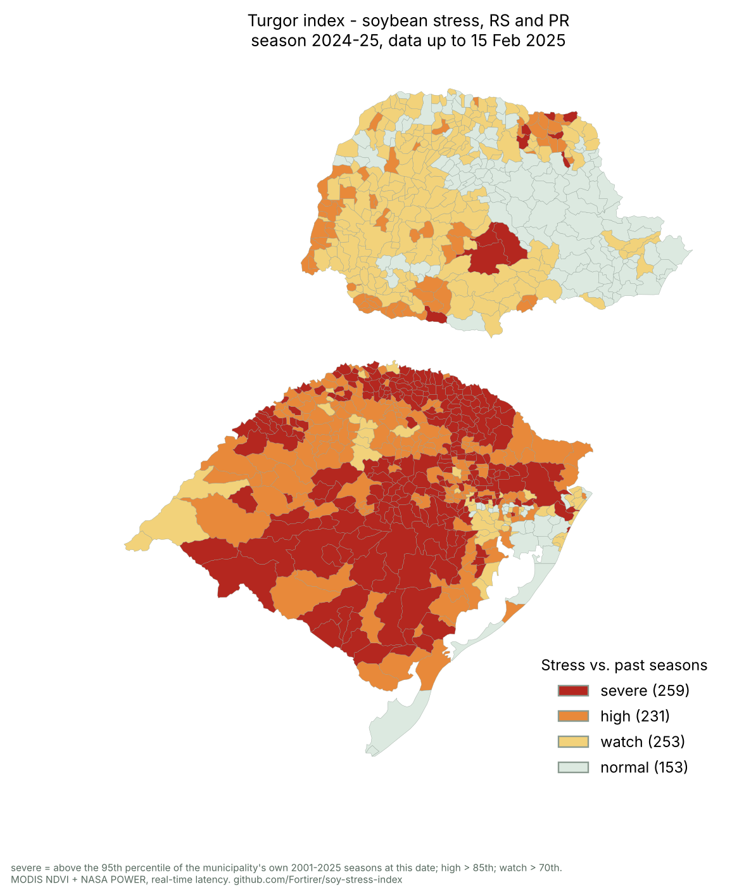
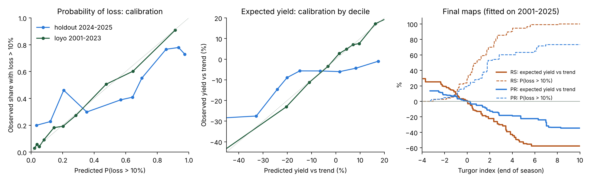
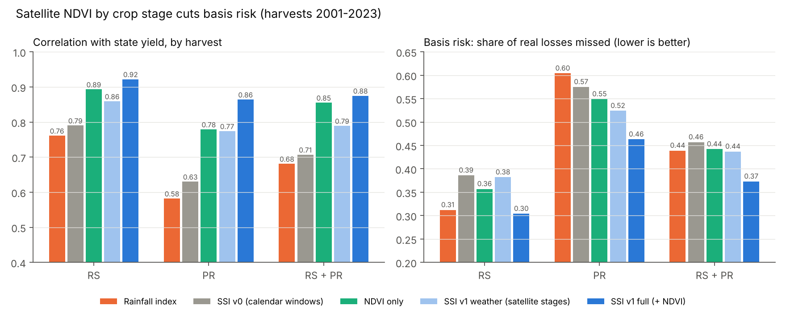
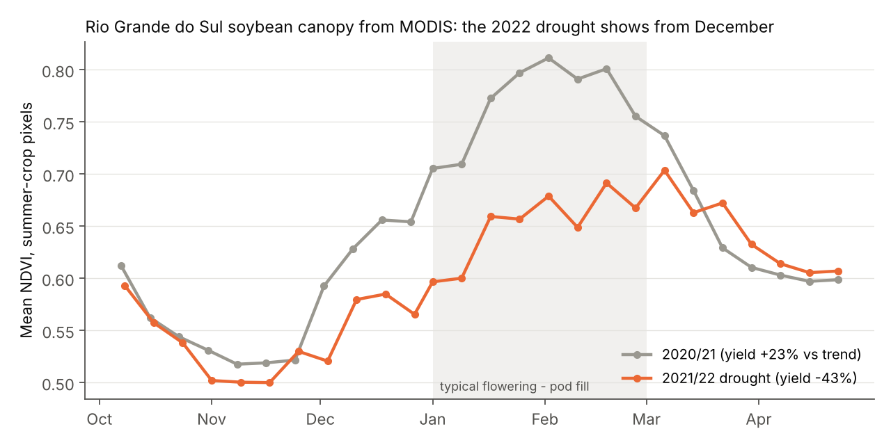
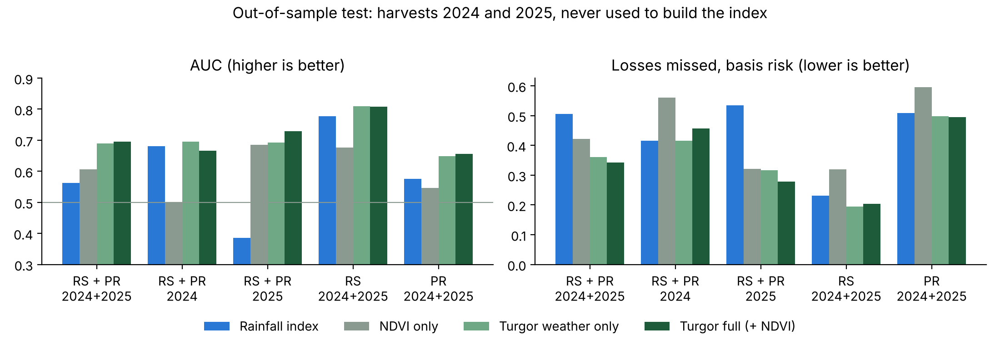
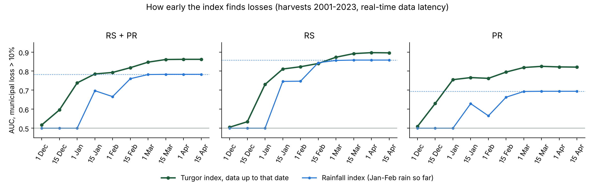
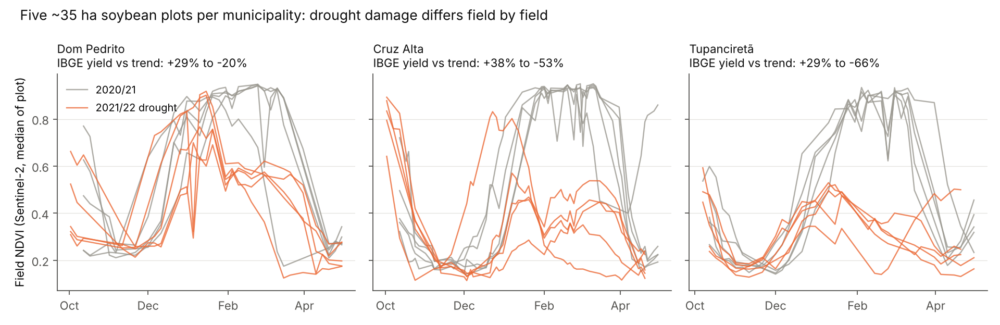
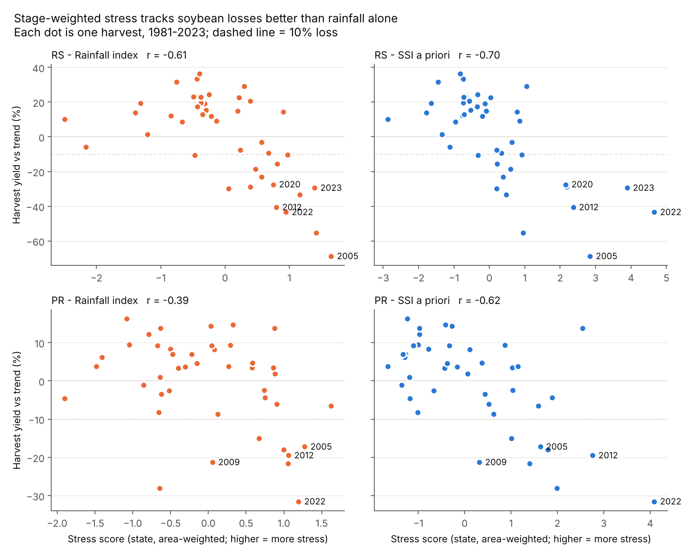
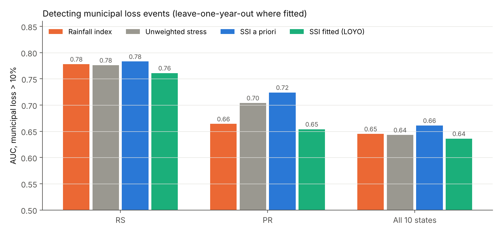

# Soybean Stage-weighted Stress Index (SSI)

**A physiology-based drought and heat stress index for soybean in Brazil, built from public weather and satellite data and weighted by crop stage.**

The index scores each municipality and season for water deficit, extreme heat and their interaction, separately for the vegetative and reproductive stages, and weights the reproductive stages (flowering, pod set, seed fill) three times more. It is the scientific core of a climate-risk product for agricultural lenders, cooperatives and insurers.

> Status: **v1 (satellite + weather by crop stage) is built and backtested** for Rio Grande do Sul and Paraná, harvests 2001-2023, **tested out of sample on 2024 and 2025**, with confidence intervals and an early-warning test. A Sentinel-2 field pilot (15 plots, 2020/21 vs 2021/22) and a ready-to-run field-yield validation for a co-op pilot are included.

> **Validation report (4 pages):** [Português](docs/report/turgor_validation_report_pt.pdf) · [English](docs/report/turgor_validation_report_en.pdf). Method, backtest with confidence intervals, the 2024-2025 test, lead time, expected loss and the limits. Rebuilt from `results/` by `scripts/23_public_report.py`.

---

## The Turgor index (product definition)

One definition is used everywhere: `ssi.early.turgor_index()`. It is the Stage-weighted Stress Index computed **the way it can run in real time**:

- stage windows = each municipality's **typical** windows (median green-up and NDVI peak of its other seasons), because the current season's NDVI peak is only known late in the season;
- data latency: NASA POWER weather 3 days late, MODIS 16-day composites 23 days late;
- `asof` date: any day of the season gives the in-season warning; `04-15` (all windows closed) gives the end-of-season value used in the backtests.

| Test | Region | Turgor index | v1, season's own windows | Rainfall index | NDVI only | ZARC |
| --- | --- | --- | --- | --- | --- | --- |
| Backtest 2001-2023, AUC | RS + PR | **0.862** | 0.828 | 0.784 | 0.773 | 0.573 |
| Backtest 2001-2023, basis risk | RS + PR | **0.33** | 0.37 | 0.44 | 0.44 | 0.64 |
| Holdout 2024-2025, AUC | RS + PR | 0.674 | **0.695** | 0.563 | 0.606 | 0.571 |
| Holdout 2024-2025, basis risk | RS + PR | 0.36 | **0.34** | 0.51 | 0.42 | 0.46 |

- In the backtest the real-time index beats the season's-own-window version in every region (RS 0.90 vs 0.87, PR 0.82 vs 0.78).
- On the two new seasons it is slightly behind overall (0.67 vs 0.70): ahead in RS (0.82 vs 0.81), behind in PR (0.64 vs 0.66), and still well ahead of rainfall, NDVI and ZARC. The difference between the two versions is small and not consistent, so the choice rests on what can run in real time: the season's own windows need the NDVI peak, which comes in February-March.
- The older versions stay in the tables below as research history (`SSI v1 full`).

## Live monitor, season 2026/27

Every week from 1 December to 15 April a GitHub Action runs `scripts/17_monitor.py` and commits a stress map and table for every municipality in RS and PR to [`monitor/`](monitor/README.md). Each week is kept, so the season is a public, timestamped record written before harvest.

Replay of 15 February 2025 (2024/25 RS drought, 2025 left out of the reference): municipalities flagged **severe** ended the season 30% below trend and 83% had a loss above 10%; **normal** ones ended +1% (AUC 0.81, two months before harvest).



## Rio Grande do Sul: trying to beat the rainfall index (issue #7)

In RS the Turgor index beats the rainfall index on average, but the municipality-level gain is not proven (95% CI includes zero). Each idea was tested alone with `scripts/19_rs_experiments.py`, scored exactly like the product index, with 1,000 resampled harvest years (`results/rs_experiments.csv`).

| RS, municipality level | AUC 2001-2023 | AUC gain vs rainfall (95% CI) | Basis risk | Basis-risk change vs rainfall (95% CI) | Holdout 2024-25 AUC / basis risk |
| --- | --- | --- | --- | --- | --- |
| Rainfall index | 0.857 | | 0.31 | | 0.777 / 0.23 |
| Turgor index (current) | 0.896 | +0.039 (-0.015 to +0.095) | 0.26 | -0.051 (-0.147 to +0.060) | 0.816 / 0.20 |
| + VPD by stage | 0.888 | +0.031 (-0.029 to +0.088) | 0.28 | -0.034 (-0.141 to +0.090) | 0.817 / 0.20 |
| MODIS at full 250 m | 0.898 | +0.041 (-0.012 to +0.096) | 0.26 | -0.052 (-0.150 to +0.061) | 0.815 / 0.20 |
| MapBiomas soybean-only mask (250 m) | 0.895 | +0.038 (-0.020 to +0.095) | 0.27 | -0.045 (-0.153 to +0.079) | 0.828 / 0.19 |
| CHIRPS rain instead of NASA POWER | not tested: the CHIRPS server's anti-bot system bans automated downloads | | | | |

What this says:

- **None of the canopy or weather changes moves RS.** VPD adds no information beyond heat and water deficit. Reading MODIS at 250 m, and keeping only MapBiomas soybean pixels (Collection 9, class 39, at least half of each 250 m pixel), give almost the same municipal curves. The soybean mask is slightly better on the 2024-2025 holdout (AUC 0.83 vs 0.82, basis risk 0.19 vs 0.20), too little to matter. How the canopy is measured is not the limit in RS.
- **The limit is statistical as much as scientific.** With 23 seasons the 95% interval on the basis-risk difference is about ±0.10 wide, so a real improvement smaller than about 0.10 cannot be proven at municipality level, whatever the model. In RS the rainfall index already reaches basis risk 0.31, because RS losses are mostly rainfall droughts.
- **Rain is the one idea left.** CHIRPS could not be tested (its server bans automated downloads); ERA5-Land (Copernicus, 0.1°, daily, needs a free API key) is the alternative. `scripts/21_chirps_rs.py` and the `chirps` variant of script 19 are ready for any daily rain table per municipality.
- **How to sell RS today:** on what is proven there: early warning (by 15 January the index reaches the rainfall index's end-of-season skill, about six weeks earlier), portfolio-level correlation (state-year r 0.91 vs 0.76, CI above zero) and the 2024-2025 holdout (basis risk 0.20 vs 0.23).

## Stage weights: prior, literature and data agree (issue #8)

The index weights reproductive-stage stress 0.75 and vegetative 0.25, a physiology prior. `scripts/22_stage_weights.py` tests it against the FAO yield-response factors for soybean (Doorenbos & Kassam 1979: vegetative 0.2, flowering 0.8, yield formation 1.0, i.e. 0.18/0.82), equal weights, reproductive only, and a weight fitted to the data season by season (leave-one-season-out).

| RS + PR | AUC 2001-2023 | Change vs prior (95% CI) | AUC 2024-2025 |
| --- | --- | --- | --- |
| **Prior 0.25 / 0.75** | **0.862** | | 0.674 |
| FAO Ky 0.18 / 0.82 | 0.861 | 0.000 (-0.004 to +0.003) | 0.665 |
| Equal 0.5 / 0.5 | 0.854 | -0.008 (-0.020 to +0.003) | 0.700 |
| Reproductive only | 0.855 | -0.006 (-0.019 to +0.004) | 0.643 |
| Fitted per season | 0.857 | -0.005 (-0.010 to -0.002) | 0.675 |

- The data choose a reproductive weight of 0.65-0.90 (median 0.75 in PR, 0.80 in RS), the FAO factors give 0.82 and the prior is 0.75: **three independent sources agree**.
- Fitting the weight does not help; it is slightly worse than the prior. The prior stays.
- Write-up for the FAPESP PIPE proposal (Portuguese), including the next step with the eCO2 x drought x warming experiments and the meta-analysis: [`docs/pipe_calibracao_estadios_pt.md`](docs/pipe_calibracao_estadios_pt.md). That step waits for data ownership to be confirmed (#17).

## Expected loss: from index to % and R$/ha

Buyers price risk in % of yield and in reais, not in z-scores. `scripts/18_expected_loss.py` maps the Turgor index, per state, to:

- **P(loss > 10%)**, the chance the municipality ends more than 10% below its yield trend;
- **expected yield vs trend** (%);
- **expected shortfall**, the mean loss below trend (gains count as zero), converted to **R$/ha** with the trend yield and the soybean price (default R$ 153.49 per 60 kg bag, CEPEA/ESALQ Paraná, 28 Sep 2026; `--price`).

The maps are isotonic (monotone) regressions: more stress never gives a better expected outcome, with no other shape imposed. Each 2001-2023 season is predicted by maps fitted on the other seasons; 2024-2025 by maps fitted on 2001-2023 only. Every municipality-season has its values in `results/expected_loss_2001_2025.csv.gz`, and the live monitor reports them every week.

| Test | Region | Brier score (P loss) | Climatology | Brier skill | Expected yield: r with observed |
| --- | --- | --- | --- | --- | --- |
| Leave-one-season-out 2001-2023 | RS + PR | 0.126 | 0.204 | **+0.38** | 0.71 |
| | RS | 0.114 | 0.220 | +0.48 | 0.76 |
| | PR | 0.139 | 0.186 | +0.25 | 0.57 |
| Holdout 2024-2025 | RS + PR | 0.236 | 0.280 | **+0.16** | 0.42 |
| | RS | 0.187 | 0.309 | +0.40 | 0.54 |
| | PR | 0.289 | 0.248 | **-0.17** | 0.36 |

Climatology = each state's past loss rate. Brier skill above 0 means better than that baseline.



- **2001-2023: well calibrated.** When the model says 92% the observed share is 91%; when it says 15%, 18% (`results/expected_loss_calibration.csv`).
- **2024-2025: useful in RS, not yet in PR.** The two new seasons had far more losses than usual (48% of municipality-seasons against 29% in 2001-2023), partly from the May 2024 floods and partly because the yield trend is extrapolated two years ahead. The model was **too confident at both ends**: municipalities given under 5% lost in 20% of cases, and those given 99% in 73%. In PR the probabilities were worse than the plain base rate.
- Probabilities are therefore capped at 2-98%, and every report states that these are base rates from past seasons, not guarantees. The next steps are a per-state recalibration as new seasons arrive and the field-yield pilot.

---

## v1 results: satellite crop stages + NDVI cut basis risk

17,342 municipality-harvests in RS and PR, 2001-2023. MODIS NDVI over summer-crop pixels in each municipality; crop stages read from each season's NDVI curve; NASA POWER daily weather summed over those stages. **No weights were fitted** (physiology priors only), so there is no training leakage.

| Region | Index | AUC, loss > 10% | State-year r | Basis risk |
| --- | --- | --- | --- | --- |
| RS + PR | ZARC risk class (official zoning) | 0.573 | 0.41 | 0.64 |
| RS + PR | Rainfall index | 0.784 | 0.68 | 0.44 |
| RS + PR | SSI v0 (calendar windows) | 0.791 | 0.71 | 0.46 |
| RS + PR | NDVI only | 0.773 | 0.85 | 0.44 |
| RS + PR | SSI v1, weather by satellite stage | 0.786 | 0.79 | 0.44 |
| RS + PR | SSI v1 full (+ NDVI), season's own windows | 0.828 | 0.88 | 0.37 |
| RS + PR | **Turgor index (real-time, typical windows)** | **0.862** | **0.86** | **0.33** |
| RS | ZARC risk class | 0.584 | 0.51 | 0.60 |
| RS | Rainfall index | 0.857 | 0.76 | 0.31 |
| RS | SSI v1 full | 0.871 | 0.92 | 0.30 |
| RS | **Turgor index** | **0.896** | **0.91** | **0.26** |
| PR | ZARC risk class | 0.535 | 0.49 | 0.73 |
| PR | Rainfall index | 0.696 | 0.58 | 0.60 |
| PR | SSI v1 full | 0.775 | 0.86 | 0.46 |
| PR | **Turgor index** | **0.821** | **0.85** | **0.39** |

- The full index **misses 15% fewer real losses** than a rainfall trigger over RS + PR (basis risk 0.44 to 0.37), and **23% fewer in Paraná** (0.60 to 0.46).
- Neither satellite nor weather alone gets there: NDVI only and weather-by-stage only both stay at 0.44. The gain comes from combining them by stage.
- Reading the stage timing from NDVI instead of a fixed Jan-Feb calendar raises the state-year correlation from 0.71 to 0.79 using weather alone.





Caveat: NDVI measures the canopy during the season, so v1 is an **in-season monitor and loss estimator**, not a pre-season forecast. That is what lenders, co-ops and parametric insurers need during the season; pre-season pricing still uses the weather climatology.

---

## Validation round (October 2026): new seasons, confidence intervals, lead time

### 1. Out-of-sample test on the 2024 and 2025 harvests

These two harvests were never used to build the index. Yields come fresh from IBGE PAM (SIDRA table 1612). Each municipality's trend and its z-score reference use 2001-2023 only, and the weights are unchanged. 1,542 municipality-harvests in RS and PR.

| Region, harvests | Index | AUC, loss > 10% | Basis risk |
| --- | --- | --- | --- |
| RS + PR, 2024+2025 | ZARC risk class | 0.571 | 0.462 |
| RS + PR, 2024+2025 | Rainfall index | 0.563 | 0.505 |
| RS + PR, 2024+2025 | NDVI only | 0.606 | 0.422 |
| RS + PR, 2024+2025 | Turgor v1 (season's own windows) | 0.695 | 0.342 |
| RS + PR, 2024+2025 | **Turgor index** | **0.674** | **0.364** |
| RS, 2024+2025 | ZARC risk class | 0.541 | 0.381 |
| RS, 2024+2025 | Rainfall index | 0.777 | 0.231 |
| RS, 2024+2025 | Turgor v1 | 0.808 | 0.203 |
| RS, 2024+2025 | **Turgor index** | **0.816** | **0.201** |
| PR, 2024+2025 | ZARC risk class | 0.607 | 0.563 |
| PR, 2024+2025 | Rainfall index | 0.575 | 0.509 |
| PR, 2024+2025 | Turgor v1 | 0.656 | 0.495 |
| PR, 2024+2025 | **Turgor index** | **0.638** | **0.487** |

- On new seasons the Turgor index **misses 28% fewer real losses** than the rainfall trigger (basis risk 0.51 to 0.36).
- The 2025 RS drought (yield 34% below trend) ranks in the top 16% of stress since 2001 (Turgor index; 12% for v1).
- Skill is lower than in the backtest (AUC 0.67 vs 0.86). Two seasons is a small sample, and part of the 2024 RS loss came from the May 2024 floods at harvest, which no drought index should flag.



### 2. Confidence intervals (2001-2023 backtest)

95% intervals from 1,000 bootstrap resamples of whole harvest years. Municipalities in the same season share weather, so rows are not independent. `results/v1_ci.csv`.

| Region | Metric | Rainfall index | Turgor index | Difference (95% CI) | Turgor better in |
| --- | --- | --- | --- | --- | --- |
| RS + PR | AUC | 0.784 (0.70-0.84) | 0.862 (0.81-0.90) | +0.078 (+0.029 to +0.134) | >99% of resamples |
| RS + PR | Basis risk | 0.44 (0.33-0.61) | 0.33 (0.25-0.46) | -0.108 (-0.20 to -0.02) | >99% |
| RS + PR | State-year r | 0.68 (0.52-0.78) | 0.86 (0.78-0.92) | +0.18 (+0.09 to +0.34) | >99% |
| PR | AUC | 0.696 (0.57-0.78) | 0.821 (0.75-0.87) | +0.125 (+0.047 to +0.214) | >99% |
| PR | Basis risk | 0.60 (0.47-0.81) | 0.39 (0.32-0.55) | -0.21 (-0.34 to -0.10) | >99% |
| RS | AUC | 0.857 (0.78-0.91) | 0.896 (0.83-0.94) | +0.039 (-0.015 to +0.094) | 92% |
| RS | Basis risk | 0.31 (0.20-0.48) | 0.26 (0.17-0.40) | -0.05 (-0.15 to +0.06) | 81% |

- **RS + PR and Paraná: the gain over rainfall is clear** on every metric.
- **Rio Grande do Sul: likely but not proven** at the municipality level (92% of resamples). RS droughts are rainfall droughts, so a rainfall index already works well there; the clear gains in RS are portfolio correlation and lead time (below).
- With the earlier v1 definition (season's own windows) the RS + PR gain was borderline (AUC +0.044, -0.003 to +0.107); the real-time definition makes it clear.

### 3. How early it warns

The index rebuilt as it would have looked on each date, using only data available then: weather 3 days late, MODIS 16-day composites 23 days late, and each municipality's typical stage windows (median of its other seasons), since the current season's stages are not known yet. `results/early_warning.csv`.

| Data up to | Turgor AUC (RS + PR) | Rainfall index AUC | Turgor basis risk |
| --- | --- | --- | --- |
| 1 Dec | 0.52 | no signal yet | |
| 1 Jan | 0.74 | no signal yet | 0.49 |
| 15 Jan | **0.79** | 0.70 | 0.41 |
| 1 Feb | 0.79 | 0.67 | 0.42 |
| 1 Mar | 0.85 | 0.78 | 0.35 |
| 15 Mar onward | 0.86 | 0.78 | 0.33 |

- **By 15 January the index already matches the rainfall index's end-of-season skill** (0.78), about 6 weeks earlier. In PR it beats the final rainfall index from 1 January.
- Typical harvest is late Feb-March in PR and March-April in RS, so a usable warning comes **8-12 weeks before harvest**.
- On the 2024-2025 holdout the same holds: by 1 January AUC 0.68 (rainfall: no signal), by 15 February 0.71 vs 0.68.
- The real-time version with typical windows ends the season at AUC 0.86, higher than the full-season version with each season's own satellite windows (0.83). In a drought the NDVI peak comes early and low, which shifts the season's own window; a fixed window keeps the collapse inside it. This is why the product (the Turgor index) uses typical windows.



### 4. ZARC: what the market uses today

ZARC (Zoneamento Agrícola de Risco Climático, MAPA/Embrapa) is the official zoning that rural credit and subsidised insurance require. It gives, per municipality, soil class, cycle and 10-day sowing window, a risk class of 20, 30 or 40% of crop failure; windows not listed are "not indicated" (scored here as 50%).

ZARC score per municipality-season: sowing date = NDVI green-up minus 20 days; soil class AD2 (soil type 2 in tables before 2023/24); the lowest-risk cycle available; the ZARC table of that safra (MAPA open data, safras 2017/18 to 2025/26; harvests before 2018 use the 2017/18 table). `scripts/15_zarc_baseline.py`, `results/baselines_ci.csv`, `results/zarc_scores.csv.gz`.

| Test | Region | Turgor index | ZARC | Rainfall | NDVI only | Turgor minus ZARC, AUC (95% CI) |
| --- | --- | --- | --- | --- | --- | --- |
| Backtest 2001-2023, AUC | RS + PR | **0.862** | 0.573 | 0.784 | 0.773 | +0.29 (+0.24 to +0.33) |
| Backtest 2001-2023, AUC | RS | **0.896** | 0.584 | 0.857 | 0.829 | +0.31 (+0.25 to +0.36) |
| Backtest 2001-2023, AUC | PR | **0.821** | 0.535 | 0.696 | 0.705 | +0.29 (+0.22 to +0.33) |
| Backtest, basis risk | RS + PR | **0.33** | 0.64 | 0.44 | 0.44 | |
| Holdout 2024-2025, AUC | RS + PR | **0.677** | 0.571 | 0.566 | 0.608 | +0.11 (+0.07 to +0.15)* |
| Holdout, basis risk | RS + PR | **0.36** | 0.46 | 0.50 | 0.42 | |

\* Holdout intervals resample municipalities (only two seasons), so they are narrower than the year-resampled backtest intervals. Turgor beats ZARC in every region of the backtest (100% of resamples) and in the RS and RS + PR holdout. In the PR holdout the gain is borderline: AUC +0.03 (-0.03 to +0.10), basis risk 0.48 vs 0.56.

- **ZARC barely separates loss seasons from normal ones** (AUC 0.54-0.61). It is a pre-season, static zoning: it says where and when sowing is risky, not how this season is going. On 2018-2023 alone, where each safra has its own table, ZARC reaches 0.62 against 0.85 for Turgor v1.
- ZARC still carries some portfolio signal (state-year r 0.41), possibly because dry springs delay sowing into riskier windows (not tested).
- Read this as "Turgor adds in-season information on top of the zoning lenders already use", not "ZARC is wrong": ZARC answers a different, pre-season question and remains an input.

### 5. Field yields: ready for a co-op pilot

Real field yields are not public, so this step needs a partner. Everything is ready:

- `scripts/13_field_validation.py`: takes the partner's field polygons and yields per field and season, reads each field's Sentinel-2 curve and stages, adds weather at the field, and compares the field index with the municipal index on the same field-seasons (AUC, basis risk, within-season ranking of fields).
- `python scripts/13_field_validation.py --demo` runs it end to end on 4 pilot plots with **synthetic** yields (a pipeline test, not a result).
- `docs/pilot_data_request_pt.md`: the one-page data request for co-ops (in Portuguese).
- `docs/piloto_kit_pt.md`: contact message, draft data-use agreement (to be reviewed with Agência USP de Inovação), timeline and how to run it.
- The script takes the files as co-ops have them: Shapefile, KML/KMZ, GeoPackage or GeoJSON in any coordinate system, and CSV or Excel with Portuguese columns (`id_talhao`, `safra` as 2022 or "2021/22", `produtividade_kg_ha` or `produtividade_sc_ha`). `--check-only` lists problems before anything is downloaded.
- The field index is the product index at field scale (each field's typical stage windows, data latency), compared with the municipal index and with a rainfall index at the field, at the end of the season and on 1 Jan, 15 Jan, 1 Feb, 15 Feb and 1 Mar. A two-page report in Portuguese for the co-op is written automatically (demo with synthetic yields: `results/field_validation_demo/relatorio_cooperativa.md`).

---

## Sentinel-2 field pilot (2020/21 vs 2021/22 drought)

Three RS municipalities with different 2022 losses. In a 10 x 10 km window in each, five ~35 ha sample plots were picked at random among cells that were at least 90% soybean in 2020/21, detected from Sentinel-2 itself (low NDVI in Oct-Nov, dense canopy in Jan-Feb; 20 m). Each plot's NDVI was followed through both seasons, and its crop stages read from its own curve.

| Municipality | IBGE yield vs trend, 2021 to 2022 | MODIS municipal change, reproductive NDVI | Sentinel-2 plots, reproductive NDVI change (5 plots) |
| --- | --- | --- | --- |
| Dom Pedrito | +29% to -20% | -14% | -8% to -37% (median -25%) |
| Cruz Alta | +38% to -53% | -31% | -12% to -61% (median -52%) |
| Tupanciretã | +29% to -66% | -26% | -27% to -49% (median -45%) |



- Plot-level NDVI loss ranks the municipalities in the same order as IBGE yield loss, and it is closer to the size of the yield loss than municipal MODIS. MODIS mixes soybean with other cover at 1 km.
- **Damage differs field by field.** In Cruz Alta, one plot lost 12% of reproductive NDVI while its neighbours lost 51-61%. A municipal index pays every field the same way; this is exactly the basis risk a field-level product removes.
- Limits: plots are sample cells, not farm boundaries (CAR or co-op polygons would replace them), there are no field yields to validate against, and only two seasons are compared. Next step: real fields with harvest records from one co-op.

Run it: `python scripts/07_sentinel2_pilot.py` then `python scripts/08_pilot_figure.py` (Sentinel-2 stacks are cached in `data/s2_cache/`).

---

## v0 results (weather only, all states, 1981-2023)

---

Backtest on 62,968 municipality-harvests in 10 Brazilian states, harvests 1981-2023. Yields from IBGE PAM, detrended per municipality; a **loss** is a harvest more than 10% below the municipality's own trend.

| Region | Index | AUC, loss > 10% | State-year r with yield | Basis risk* |
| --- | --- | --- | --- | --- |
| RS | Rainfall index (Jan-Feb rain) | 0.778 | 0.61 | 0.37 |
| RS | **SSI a priori** | **0.783** | **0.70** | 0.40 |
| PR | Rainfall index | 0.664 | 0.39 | 0.61 |
| PR | **SSI a priori** | **0.724** | **0.62** | **0.56** |
| RS + PR | Rainfall index | 0.725 | 0.52 | 0.48 |
| RS + PR | **SSI a priori** | **0.753** | **0.65** | 0.48 |

\* Basis risk: the index is turned into a trigger that pays in as many municipality-seasons as losses really occur; basis risk is the share of real losses it misses (equal to the share of payouts that go to non-losses). Lower is better.

**Named drought harvests** (percentile of each harvest's stress among all years in that state; 100 = most stressed year on record):

| State | Harvest | Yield vs trend | Rainfall index | SSI a priori |
| --- | --- | --- | --- | --- |
| RS | 2005 | -68.8% | 100 | 95 |
| RS | 2012 | -40.6% | 81 | 93 |
| RS | 2020 | -27.5% | 79 | 88 |
| RS | 2022 | -43.4% | 88 | **100** |
| RS | 2023 | -29.5% | 95 | 98 |
| PR | 2012 | -19.5% | 93 | 98 |
| PR | 2022 | -31.6% | 95 | **100** |



**What the backtest says**

- Adding heat, the heat x dry interaction and stage weighting improves on rainfall alone, most of all in Paraná (state-year correlation 0.39 to 0.62).
- **Physiology priors beat fitted weights.** Weights learned by logistic regression (leave-one-year-out) do worse than the a-priori stage weights in every region. With few drought years, the prior generalizes better than the data alone.
- The signal is strong in the south (RS, PR) and weak in Mato Grosso and Goiás, where rainfall is more reliable and other factors drive yield. The product should start in the south.



---

## How the index works

```
SSI = 0.25 * Stress(vegetative) + 0.75 * Stress(reproductive)

Stress(stage) = Z(water deficit) + 0.5 * Z(extreme heat) + 0.5 * max(Z water, 0) * max(Z heat, 0)
                - Z(NDVI)                      <- v1, from satellite
```

- **Z** = standardized anomaly against each municipality's own record, so the index measures stress relative to what is normal there.
- **Water deficit**: crop water demand (ET0) not met by rain and stored soil water.
- **Extreme heat**: degree-days above 30 °C.
- **Heat x dry**: heat is mostly harmless when water is available and damaging when it is not (found in the companion Illinois analysis).
- **Stages**:
  - v0 uses the calendar critical window (Jan-Feb) from the source data.
  - v1 reads green-up and peak from each municipality's NDVI curve:
    - vegetative = green-up to 16 days before peak;
    - reproductive = 16 days before to 40 days after peak.

## Pipeline

| Step | Data | Script |
| --- | --- | --- |
| NDVI per municipality, cropland pixels only, 16-day composites 2001-2023 | MODIS MOD13Q1 (250 m) + MCD12Q1 cropland mask, Microsoft Planetary Computer | `04_download_modis.py` |
| Crop stages per municipality-season from the NDVI curve | derived | `04_download_modis.py` |
| Daily weather per municipality, water balance, heat, VPD by stage window | NASA POWER | `05_download_power.py` |
| Full index and comparison with v0, NDVI only and rainfall | | `06_full_index.py` |
| Field-scale NDVI for sample plots, 2 seasons | Sentinel-2 L2A (20 m) | `07_sentinel2_pilot.py`, `08_pilot_figure.py` |

**Satellite details.** MOD13Q1 (Terra and Aqua, 8-day spacing) is read at about 1 km from the COG overviews. Pixels must be IGBP cropland (MCD12Q1) *and* show a summer cycle: low NDVI in Oct-Nov, high in Jan-Mar, amplitude at least 0.15. This removes pasture, forest and winter-wheat-only pixels. Stages per municipality-season:

- green-up: half-amplitude rise after the Oct-Dec minimum;
- peak: Dec-Mar maximum;
- reproductive window: 16 days before to 40 days after the peak.

## Run it

```bash
pip install -r requirements.txt
git clone --depth 1 https://github.com/Fortirer/-Modelling-soybean.git ../Modelling-soybean
python scripts/01_build_panel.py ../Modelling-soybean   # yields + weather, year-aligned
python scripts/02_weather_index.py                      # v0 backtest
python scripts/03_figures.py
# v1 - downloads from planetarycomputer.microsoft.com, *.blob.core.windows.net
# and power.larc.nasa.gov (about 45 min per state for MODIS; results are in data/ already)
python scripts/04_download_modis.py --states RS PR
python scripts/05_download_power.py --states RS PR
python scripts/06_full_index.py
python scripts/03_figures.py
# validation round
python scripts/10_confidence_intervals.py               # year-block bootstrap
python scripts/11_early_warning.py                      # skill by date
python scripts/04_download_modis.py --states RS --first 2024 --last 2025   # then PR
python scripts/09_extend_weather.py                     # POWER to May 2025
python scripts/12_holdout_2024_2025.py                  # needs apisidra.ibge.gov.br
python scripts/14_validation_figures.py
python scripts/15_zarc_baseline.py --offline          # ZARC tables in data/zarc/ (MAPA open data)
python scripts/16_monitor_reference.py                # once: past seasons on weekly anchors
python scripts/17_monitor.py --asof 2025-02-16          # live monitor (default: today)
python scripts/23_public_report.py                       # validation report, PT and EN
python scripts/13_field_validation.py --fields F.geojson --yields Y.csv   # co-op pilot
pytest -q                                                 # offline tests
```

## Data note: year alignment in the source repo

In `Modelling-soybean`, Brazilian weather aggregates are keyed by **crop year** (season start, Sep of Y), while IBGE yields are keyed by **harvest year** (Y+1). Joining them on the same year pairs each harvest with the previous season's weather.

In Rio Grande do Sul, this drops the correlation between Jan-Feb water deficit and yield from **-0.48 (aligned) to -0.08 (as joined)**. `ssi/data.py` shifts weather by one year before joining. The Brazilian results in the source repo should be re-run with the same fix.

## Repository layout

```
ssi/          config, data loading, index, evaluation, satellite, weather
scripts/      01-06 pipeline steps
data/         panel.csv.gz (municipal yields + weather), municipalities.geojson
results/      metrics, drought-year tables, municipal scores
figures/      backtest figures
tests/        offline tests (synthetic NDVI and weather)
```

## Limits

- MODIS at about 1 km mixes soybean with other summer crops (maize, rice in RS). A soybean map (MapBiomas) or 250 m reads would sharpen it.
- The summer-crop mask can drop the worst-hit pixels in severe droughts (low amplitude), which may understate NDVI losses in those years.
- Stage windows use fixed offsets around the NDVI peak; calibrating them on field phenology (e.g. Embrapa trials) is the next step.
- Municipal yields average many farms; field-level skill needs pilot data from cooperatives.
- The 2024-2025 holdout covers only two seasons; it will grow by one season a year.
- In Rio Grande do Sul the index does not clearly beat a rainfall index at the municipality level (see confidence intervals).

## License and credit

MIT. Yields and weather features from [Modelling-soybean](https://github.com/Fortirer/-Modelling-soybean) (J. Fortirer). Satellite data: NASA MODIS and ESA Sentinel-2 via Microsoft Planetary Computer. Weather: NASA POWER.
