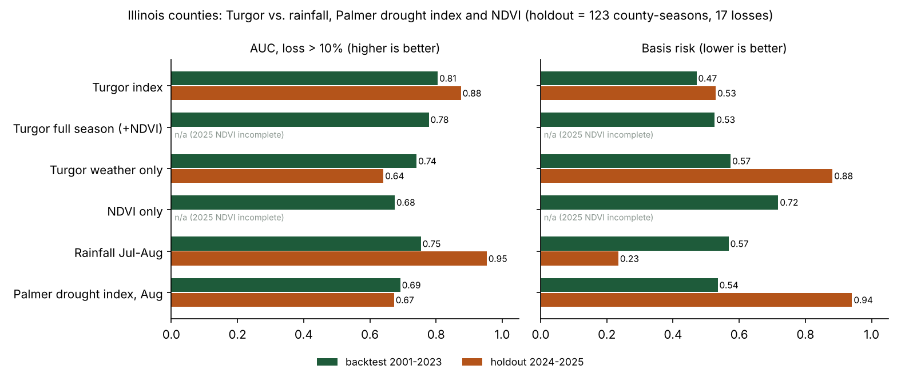
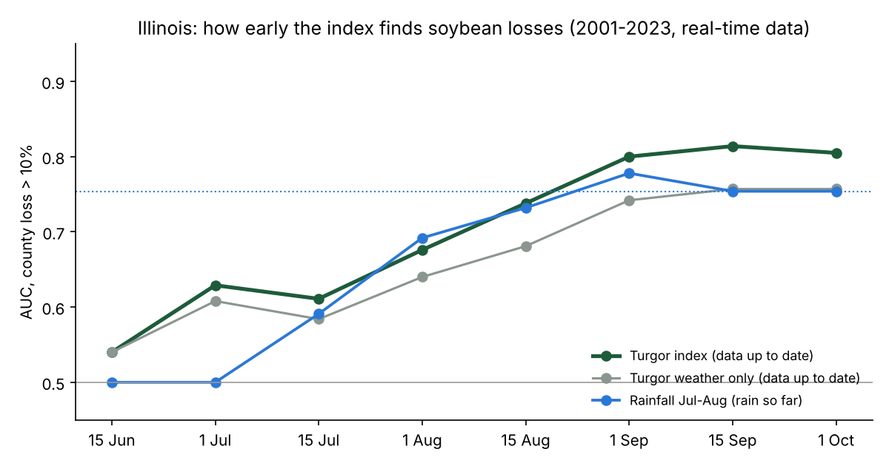
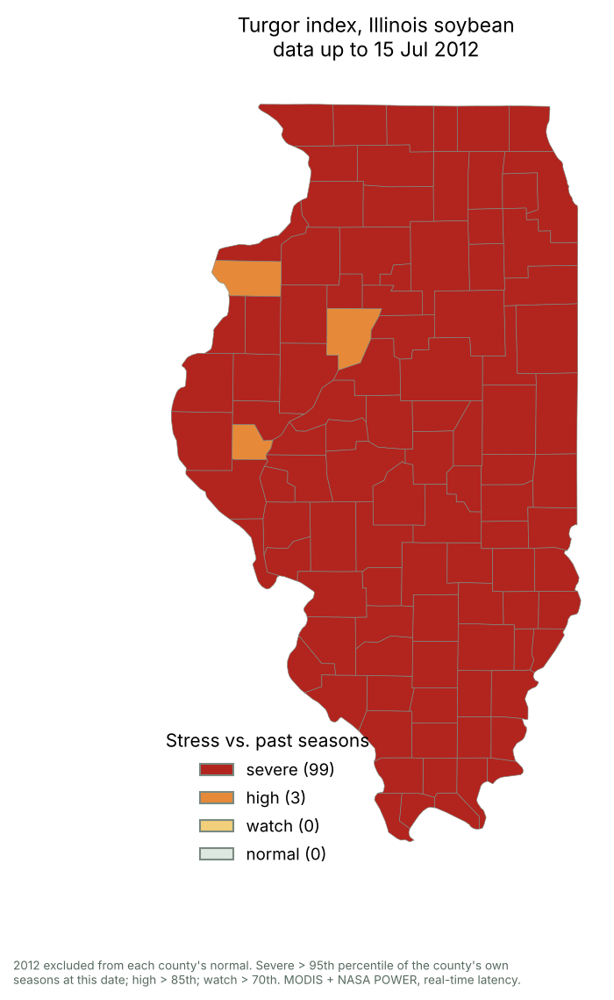

# Turgor in the US Midwest: Illinois validation and US business analysis

This folder repeats the Brazilian analysis for Illinois soybean, with the same method, the same priors and the same honesty rules. It also adds a weather-only check across 12 Midwest states and a US business pack. Everything here is in English.

**Bottom line**

- **Illinois backtest (2001–2023, 102 counties, 2,194 county-seasons):** the Turgor index ranks loss seasons better than July–August rainfall (AUC 0.81 vs 0.75), misses fewer real losses (basis risk 0.47 vs 0.57) and tracks the statewide yield better (r 0.60 vs 0.44). The Palmer drought index and NDVI alone do worse than both.
- **But the gain over rainfall is not statistically proven in Illinois:** the index beats rainfall in 78% (AUC) and 85% (basis risk) of 1,000 resampled season sets. The 95% intervals include zero. This is the same situation as Rio Grande do Sul.
- **On the new seasons 2024–2025, rainfall did better** (AUC 0.95 vs 0.88). This is a small test: 123 county-seasons, 17 losses, almost all in 2025, and the satellite archive is missing most July–October 2025 composites.
- **Early warning is shorter than in Brazil.** By 1 September the index already beats the rainfall index's end-of-season skill (0.80 vs 0.75), about 4–6 weeks before the Illinois harvest. Before mid-August the two are level.
- **Across 12 Midwest states, weather alone does not beat July–August rainfall** (AUC 0.71 vs 0.74). In the US the gain comes from the canopy (NDVI) part of the index, not from the weather stages alone.
- **Business:** the US is a smaller, more crowded and better-insured market than Brazil for this product. Illinois is most useful as **evidence that the method travels**, and as a door to global buyers (reinsurers, Arbol), rather than as the first market.

## 1. What was done

| Step | Script | Notes |
| --- | --- | --- |
| County panel | `scripts/01_build_illinois.py` | USDA NASS county soybean yields and acres, 1980–2025 (via the Modelling-soybean repo). Trend: Theil–Sen per county on 1990–2023 only. Loss = yield > 10% below trend |
| Satellite | `scripts/02_modis_ndvi.py` | MODIS NDVI (250 m, read at 0.01°), only pixels where corn + soybean cover ≥ 50% in the USDA Cropland Data Layer (2019–2021) and with a clear summer canopy cycle. Crop stages from each county-season's NDVI curve |
| Weather | `scripts/03_power_weather.py` | NASA POWER daily, county centroids, 2000–2025 |
| Index inputs | `scripts/04_features.py` | Water deficit, extreme degree days > 30 °C and NDVI per stage. Product version: typical windows plus real-time latency |
| Validation | `scripts/05_validate.py` | Backtest, year-block bootstrap, holdout, early warning, drought years, expected loss |
| 2012 replay | `scripts/06_replay_2012.py` | Maps as the weekly monitor would have shown them; 2023 as a false-alarm check |
| Figures | `scripts/07_figures.py` | `figures/` |
| Midwest check | `scripts/08_midwest_weather_check.py` | 12 states, weather only |
| Market | `scripts/10_market_size.py` | `figures/us_market_size_slide.png` |
| One-pager | `scripts/11_onepager.py` | `report/turgor_illinois_onepager.pdf` |

**What is unchanged from Brazil:** the index formula, the stage weights (0.25 vegetative / 0.75 reproductive), the component weights, z-scores against each county's own record, the latency rules (weather +3 days, MODIS +23 days) and the evaluation code (`ssi/`). Nothing was tuned on Illinois.

**What changes:**

- **The calendar:** the season runs 1 April – 31 October. The canopy minimum is searched from 15 April to 15 June and the peak from 1 July to 31 August. Illinois typical windows are vegetative ~10 June–13 July and reproductive ~13 July–6 September.
- **The baselines:** July–August rainfall (the usual US weather-index window) and the August Palmer Drought Severity Index, in place of January–February rain and ZARC.

**Limit of the satellite signal:** Illinois rotates corn and soybean field by field, so a 1 km pixel mixes both crops, and the NDVI peak (median day 211, end of July) is a corn–soybean mix. A soybean-only mask needs the Cropland Data Layer of each year at 30 m. Planetary Computer only has it to 2021, so this is the next improvement.

## 2. Backtest 2001–2023

| Index | AUC, loss > 10% (95% CI) | Basis risk (95% CI) | Statewide-year r |
| --- | --- | --- | --- |
| **Turgor index** (real-time product) | **0.805** (0.64–0.90) | **0.47** (0.31–0.75) | **0.60** |
| Turgor, full season (each season's own windows) | 0.778 | 0.53 | 0.53 |
| Turgor, weather only | 0.741 | 0.57 | 0.50 |
| Rainfall July–August | 0.754 (0.59–0.88) | 0.57 (0.41–0.83) | 0.44 |
| Palmer drought index, August | 0.692 | 0.54 | 0.34 |
| NDVI only | 0.675 | 0.72 | 0.44 |

Turgor minus rainfall:

- AUC +0.05 (−0.07 to +0.16), better in 78% of resamples.
- Basis risk −0.10 (−0.27 to +0.08), better in 85%.
- Statewide-year r +0.16 (−0.25 to +0.42), better in 83%.

With 23 seasons and one state, the intervals are wide. A real gain of this size would need more seasons or more states to be proven. `results/il_metrics.csv`, `results/il_backtest_ci.csv`



**Named years** (statewide stress percentile among 2001–2023; 100 = most stressed):

| Season | Yield vs trend | Turgor index | Rainfall Jul–Aug | Palmer Aug | NDVI only |
| --- | --- | --- | --- | --- | --- |
| 2012 drought | −17% | **100** | 91 | 100 | 100 |
| 2003 (late-August drought; soybean aphid outbreak) | −17% | **78** | 22 | 57 | 65 |
| 2007 | −9% | **83** | 61 | 91 | 43 |
| 2011 | −6% | 74 | **96** | 70 | 57 |
| 2009 (cool, wet, late planting) | −5% | 13 | 13 | 4 | 30 |

- 2003 is the case for the method: July–August rain looked normal, but the crop was stressed at seed fill.
- 2009 shows its boundary: losses from a cool, wet season are not drought or heat stress, and no index here should flag them.

## 3. New seasons 2024–2025 (holdout)

Normals and trends come from 2001–2023 only.

| Index | AUC | Basis risk |
| --- | --- | --- |
| Turgor index | 0.875 | 0.53 |
| Rainfall July–August | **0.953** | **0.24** |
| Palmer drought index, August | 0.673 | 0.94 |
| Turgor, weather only | 0.641 | 0.88 |

Read this with care:

- There are 123 county-seasons with NASS yields (61 in 2024, 62 in 2025) and only 17 losses, 15 of them in 2025.
- In 2025, the Planetary Computer MODIS archive is missing most July–October composites over Illinois, so the index ran mostly on weather and June NDVI.
- The result is a warning that the US July–August rainfall index is a strong competitor. Do not read it as a measure of the index's skill.

## 4. How early



| Data up to | Turgor index AUC | Rainfall (rain so far) AUC |
| --- | --- | --- |
| 1 July | 0.63 | 0.50 (no signal yet) |
| 1 August | 0.68 | 0.69 |
| 15 August | 0.74 | 0.73 |
| **1 September** | **0.80** | 0.78 |
| 1 October | 0.81 | 0.75 |

In Illinois, soybean yield is decided in August (pod fill), and the rain index sees August rain as it falls. The index's lead is therefore smaller than in Brazil: it reaches the rainfall index's final skill around 1 September, 4–6 weeks before harvest, versus 8–12 weeks in southern Brazil. `results/il_early_warning.csv`

## 5. The 2012 drought, replayed



- **15 July 2012:** 2012 was left out of every county's normal, and only data available on that date was used. 99 of 102 counties were rated severe. Of the 93 severe counties with NASS yields, the average ended 17% below trend, and 72% lost more than 10%. Because almost the whole state was severe, the map tells a lender or insurer "this is a statewide bad year" before soybean seed fill had even begun; it does not rank counties within that year (within-2012 AUC 0.67).
- **False-alarm check, 2023:** on 1 August 2023, after the June flash drought, 18 counties were rated severe, but all ended above trend (+7%). July and August rain rescued the crop. In Illinois the monitor needs to say "June stress, still recoverable" until August.

`results/il_replay_summary.csv`, `figures/il_replay_*.png`

## 6. Expected loss

| Test | Brier skill vs climatology | Expected yield r |
| --- | --- | --- |
| Leave-one-season-out, 2001–2023 | +0.12 | 0.46 |
| Holdout 2024–2025 | +0.10 | 0.53 |

The skill is lower than in Brazil (+0.38). At US$ 12.55/bu (soybean futures, 22 Oct 2026), the average shortfall below trend in Illinois was:

- US$ 23.5/acre a year over 2001–2025, but only US$ 7.9/acre over 2016–2025, a run of good seasons;
- US$ 57/acre in a bad year (90th percentile);
- US$ 104/acre in 2012.

`results/il_expected_loss_*.csv`, `results/il_value_anchors.csv`

## 7. Midwest, 12 states, weather only

The Modelling-soybean panel has water deficit and extreme heat in each county's crop-model R3–R6 window, so the stage-weighted weather part can be tested on 18,544 county-seasons. NDVI was not used here.

| Region | Turgor weather-only AUC | Rainfall Jul–Aug AUC | Palmer Aug AUC |
| --- | --- | --- | --- |
| All 12 states, 2001–2023 | 0.71 | **0.74** | 0.69 |
| Kansas | **0.82** | 0.76 | 0.78 |
| Missouri | 0.80 | 0.80 | 0.80 |
| Iowa | 0.78 | 0.81 | 0.74 |
| Illinois | 0.77 | 0.78 | 0.69 |
| Minnesota, Michigan, Wisconsin, North Dakota | 0.55–0.67 | 0.62–0.77 | 0.61–0.67 |
| All 12 states, holdout 2024–2025 | 0.57 | **0.70** | 0.55 |

- Weather alone does not beat rainfall across the Midwest (gain −0.03, −0.09 to +0.01). It is weakest in the northern states, where cool, wet seasons and early frost drive losses.
- It does best in the drier south-west (Kansas).
- The stage-weighted weather terms only beat rainfall when the canopy signal is added, as in Illinois (weather only 0.74 → full index 0.81).

The next scientific step is the full index with NDVI across Iowa, Indiana and Nebraska. `results/midwest_weather_check*.csv`

## 8. Business (folder `business/`)

| File | What |
| --- | --- |
| [market_and_pricing.md](business/market_and_pricing.md) | TAM, SAM and SOM, value anchors, price hypotheses |
| [competitors.md](business/competitors.md) | Agrograph, CeresAI, EarthDaily, Arbol; Gro Intelligence's closure as a warning |
| [customers_and_interviews.md](business/customers_and_interviews.md) | Segments, interview script, first-contact message |
| [founder_and_funding_us.md](business/founder_and_funding_us.md) | Visa questions for UIUC ISSS, SBIR ownership rules, UIUC programs (I-Corps) |
| [lean_canvas_us.md](business/lean_canvas_us.md) | US canvas, evidence vs hypotheses |
| [loi_template_us.md](business/loi_template_us.md) | Letter of intent for a US pilot |
| [report/turgor_illinois_onepager.pdf](report/turgor_illinois_onepager.pdf) | One page for the hackathon and US meetings |

## 9. Reproduce

```bash
python midwest/scripts/01_build_illinois.py /path/to/soystress-mvp/data   # needs us_panel.csv.gz from Modelling-soybean
python midwest/scripts/02_modis_ndvi.py            # ~1 h; resumable, --part for parallel runs, then --stages-only
python midwest/scripts/03_power_weather.py
python midwest/scripts/04_features.py
python midwest/scripts/05_validate.py --price 12.55
python midwest/scripts/06_replay_2012.py
python midwest/scripts/07_figures.py
python midwest/scripts/08_midwest_weather_check.py
python midwest/scripts/10_market_size.py
python midwest/scripts/11_onepager.py
```

The daily weather cache (`data/power/`) is not committed. The MODIS county series, stages and features are.
