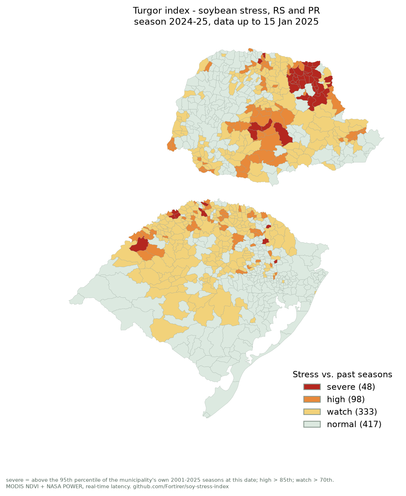

# Turgor monitor - season 2024-25, data up to 2025-01-15

Municipalities by class: severe 48, high 98, watch 333, normal 417

## 20 most stressed municipalities

| # | State | Municipality (IBGE) | Turgor index | Percentile vs past | Class | Past loss frequency* | Main driver |
| --- | --- | --- | --- | --- | --- | --- | --- |
| 1 | PR | Boa Ventura De São Roque | 7.29 | 100 | severe | 69% | heat |
| 2 | PR | Barra Do Jacaré | 7.16 | 96 | severe | 69% | water deficit |
| 3 | PR | Abatiá | 6.58 | 96 | severe | 69% | water deficit |
| 4 | PR | Nova América Da Colina | 6.47 | 96 | severe | 69% | water deficit |
| 5 | PR | Cambará | 6.40 | 96 | severe | 69% | water deficit |
| 6 | PR | Bandeirantes | 6.38 | 96 | severe | 69% | water deficit |
| 7 | PR | Congonhinhas | 6.36 | 96 | severe | 69% | water deficit |
| 8 | PR | Jundiaí Do Sul | 6.35 | 96 | severe | 69% | water deficit |
| 9 | PR | Cornélio Procópio | 6.34 | 96 | severe | 69% | water deficit |
| 10 | PR | Andirá | 6.08 | 96 | severe | 69% | water deficit |
| 11 | PR | Santo Antônio Do Paraíso | 6.07 | 96 | severe | 69% | water deficit |
| 12 | PR | Conselheiro Mairinck | 6.02 | 96 | severe | 69% | water deficit |
| 13 | PR | Nova Fátima | 5.98 | 96 | severe | 69% | water deficit |
| 14 | PR | Santa Maria Do Oeste | 5.97 | 100 | severe | 69% | water deficit |
| 15 | PR | Santo Antônio Da Platina | 5.78 | 96 | severe | 69% | water deficit |
| 16 | PR | Japira | 5.73 | 96 | severe | 69% | heat |
| 17 | PR | Ribeirão Do Pinhal | 5.59 | 96 | severe | 69% | water deficit |
| 18 | RS | Tupanci Do Sul | 5.50 | 100 | severe | 69% | water deficit |
| 19 | PR | São Jerônimo Da Serra | 5.47 | 96 | severe | 69% | water deficit |
| 20 | PR | Uraí | 5.41 | 96 | severe | 69% | heat |

\* Share of past municipality-seasons (2001-2025) with yield more than 10% below trend, among those with a similar index at this date. Not a forecast of this season's yield.
