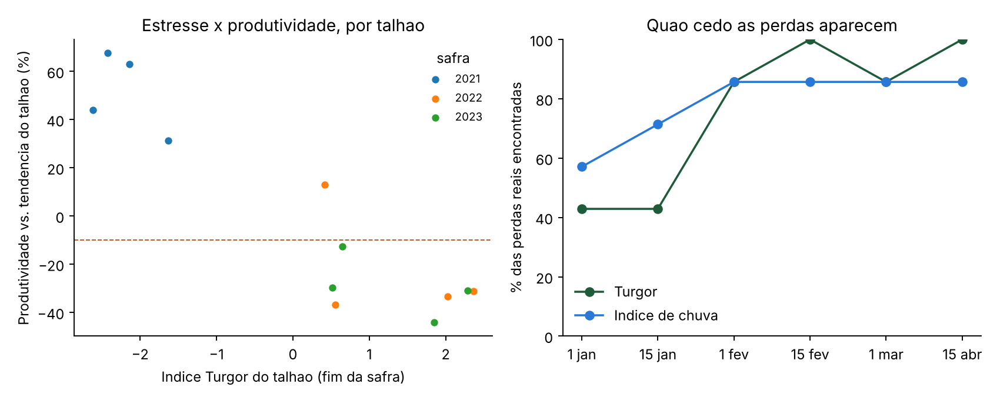

# Piloto Turgor - cooperativa parceira
> **DEMONSTRACAO com produtividades SINTETICAS. Estes numeros nao sao resultado.**

4 talhoes, safras 2021, 2022, 2023, 12 talhao-safras com produtividade. Perda = produtividade mais de 10% abaixo da tendencia do proprio talhao (58% dos casos).

## Resultado no fim da safra

| Indice | Perdas reais encontradas* | AUC | Ordena talhoes na mesma safra (r) |
| --- | --- | --- | --- |
| Indice Turgor do talhao | 100% | 1.00 | 0.40 |
| Indice de chuva no talhao | 86% | 0.96 |  |
| Indice Turgor do municipio | 86% | 0.84 |  |

\* Com o gatilho calibrado para disparar no mesmo numero de talhao-safras em que houve perda.

## Quao cedo

| Dados ate | Perdas encontradas - Turgor | Perdas encontradas - chuva |
| --- | --- | --- |
| 1 jan | 43% | 57% |
| 15 jan | 43% | 71% |
| 1 fev | 86% | 86% |
| 15 fev | 100% | 86% |
| 1 mar | 86% | 86% |
| 15 abr | 100% | 86% |

Talhao a talhao: `field_scores.csv`. Dados usados apenas neste teste, conforme o termo assinado.
